# My Account Dashboard Builder

**My Account Dashboard Builder** allows your WooCommerce store to turn the plain **My Account**
page into a branded customer dashboard.

**My Account Dashboard Builder** turns the plain WooCommerce **My Account** page into a branded
customer dashboard. Reorder and add menu items, design the page beside a live preview, add
banners and personal offers, and give customers self-service tools — without editing theme
templates or writing code.

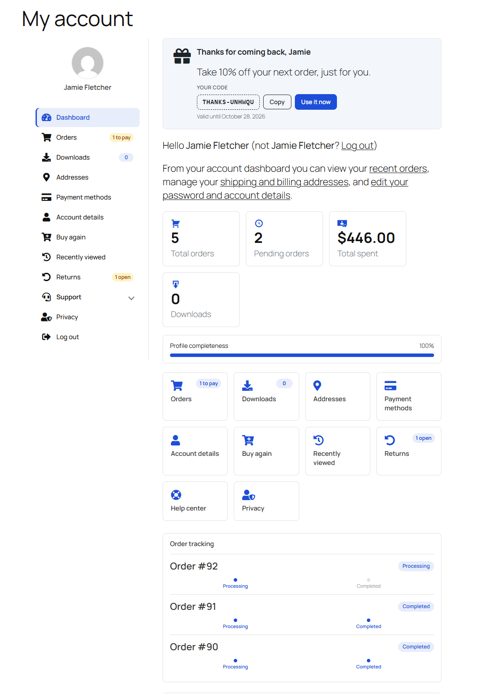

---

## Installation

1. In WordPress admin, go to **Plugins → Add New → Upload Plugin**.
2. Upload `my-account-dashboard-builder.zip` and click **Install Now**.
3. Click **Activate**. WooCommerce must be installed and active.
4. Open **WooCommerce → Account Dashboard**.

> Requires WordPress 6.0+, WooCommerce 6.0+ and PHP 7.4+.

The default WooCommerce pages are already loaded, so My Account keeps working before you
change anything.

---

## Setup and Configuration

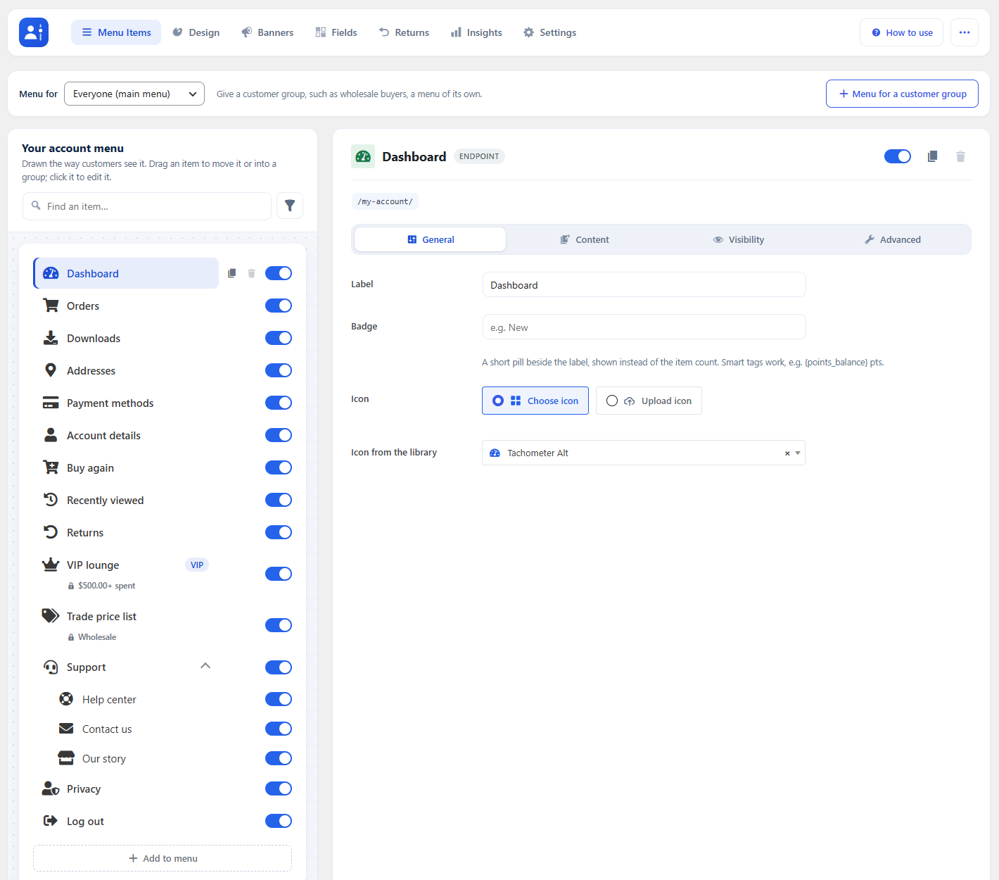

### Getting started

To set up your store with My Account Dashboard Builder, go to **WooCommerce → Account
Dashboard**. The screen has four parts:

1. **Top section** — the tabs (*Menu Items, Design, Banners, Fields, Returns, Insights,
   Settings*), **How to use** (a searchable guide to every feature) and **⋯** (*Preview* and
   *View My Account*).
2. **Left panel** — the menu canvas: your account menu drawn the way customers see it.
3. **Main content area** — the options of the item you select.
4. **Bottom section** — **Save menu**. The save bar floats in view while there are unsaved
   changes, and leaving the page asks first.

### Menu Items

There are four item types: **Endpoint** (a page inside My Account, built-in or your own),
**Group** (a collapsible heading), **Link** (any URL) and **Page** (a WordPress page).

#### Endpoint Controls

- **Drag** an item to reorder it, or drop it into a group. **Alt + arrow keys** do the same.
- The **switch** shows or hides an item without deleting it.
- Hover an item for **Duplicate** and **Delete**. Built-in items can be switched off but not
  deleted.
- A line under an item sums up who sees it, e.g. *Customer · 2+ orders*.

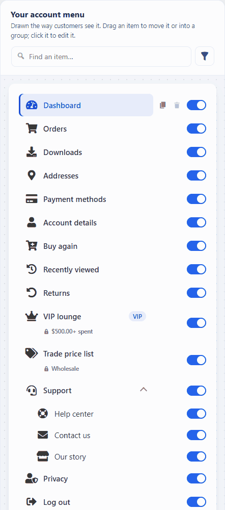

#### Endpoint Options

Click an item to edit it. Its options are grouped in four tabs:

- **General** — label, address (custom endpoints), badge text and icon (Font Awesome
  library or your own image).
- **Content** — Classic or Block editor content shown before, after or instead of the
  default page; smart tags work here. Attach banners at the top or bottom.
- **Visibility** — limit the item by user role, dates, products bought, number of orders,
  amount spent or days since the last order.
- **Advanced** — an extra CSS class and the item key.

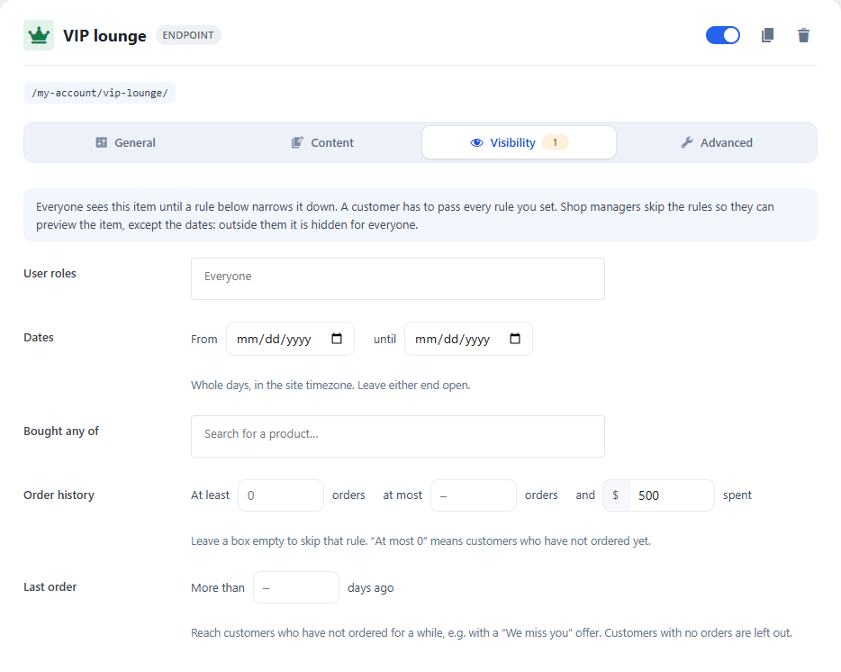

#### Add an Endpoint, Group, Link or Page

1. Click **Add to menu** under the menu.
2. Pick the type, type a label and click **Add item**. It is added at the end of the menu.
3. Set its options (a link's URL, a page's WordPress page) and drag it where it belongs.
4. Click **Save menu**.

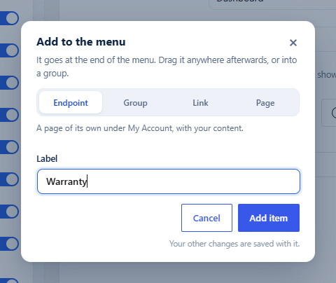

#### Menus for Customer Groups

Give wholesale buyers or members a menu of their own: click **Menu for a customer group**,
name it and tick the roles. It starts as a copy of the main menu; take items out, add others
and reorder it. Item settings stay shared, and everyone else keeps the main menu.

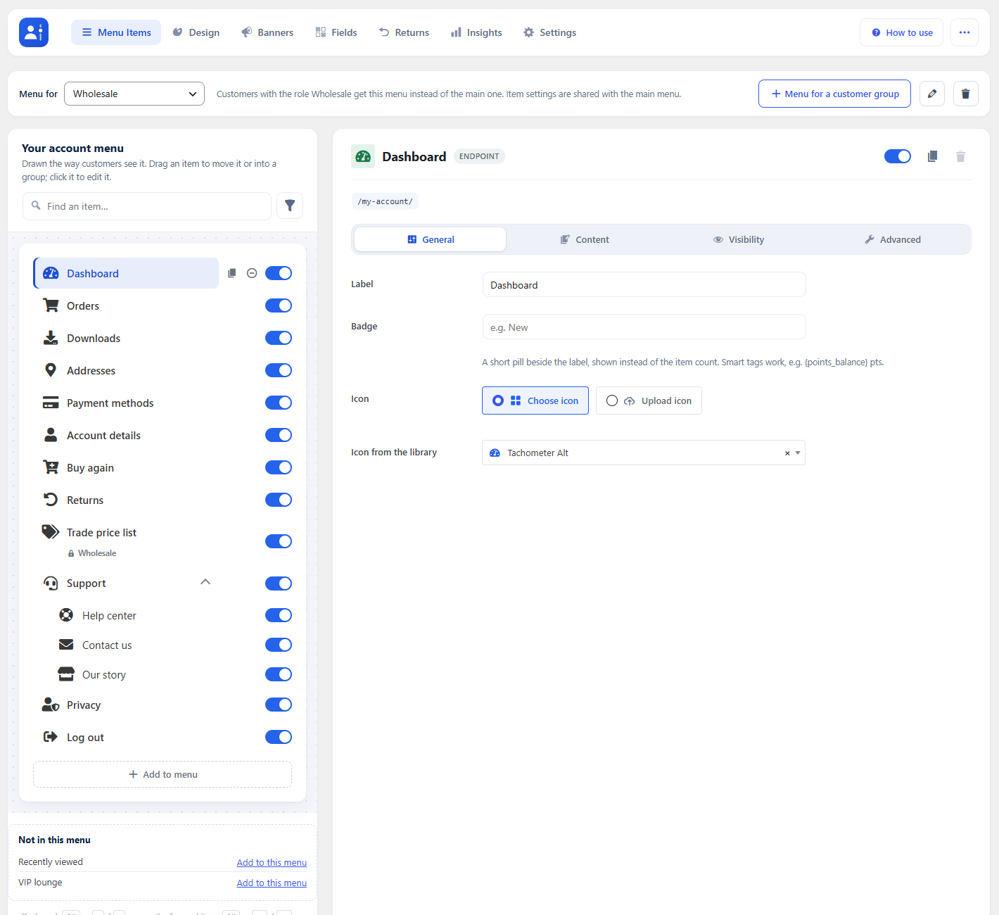

### Design Studio

**Design** holds every look setting, beside a live preview of the real account page at
desktop, tablet and phone widths. Nothing changes on your site until you click **Save design**.

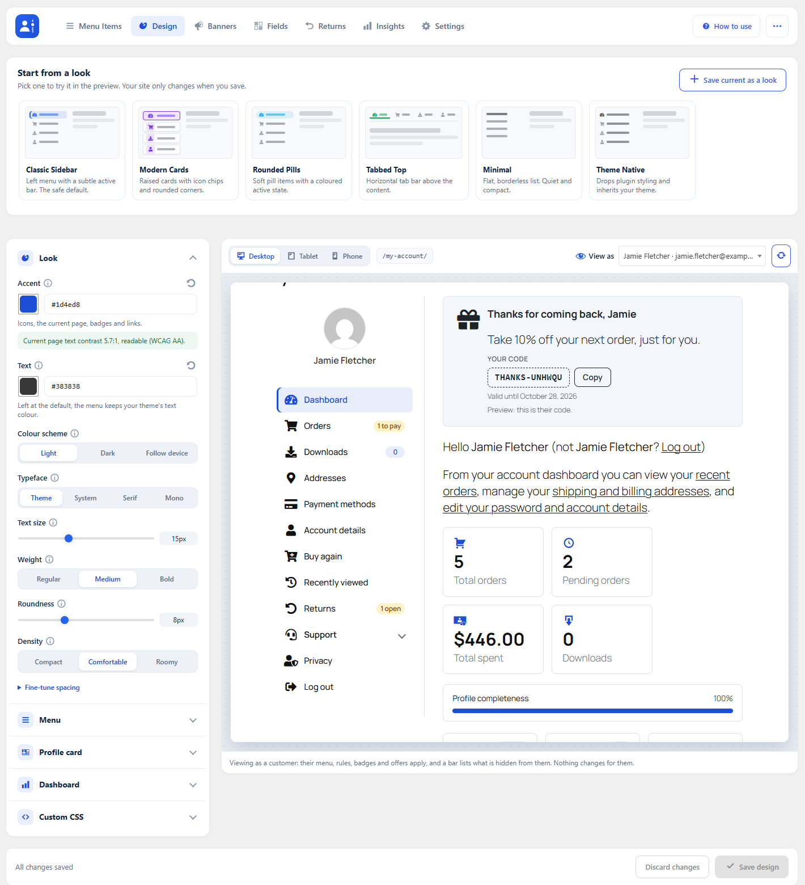

#### Ready-made Looks

Start from **Classic Sidebar, Modern Cards, Rounded Pills, Tabbed Top, Minimal** or **Theme
Native**. Click one to try it in the preview. **Save current as a look** keeps your own design
as one more card.

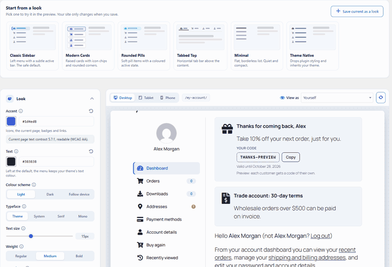

#### Design Controls

- **Look** — accent and text colours (with a live WCAG contrast check), light or dark scheme,
  typeface, size, weight, roundness and density.
- **Menu** — style, placement (left, right or above the content), current-page marker, hover
  effect, colours, icons, counts, **status badges** (*1 to pay*, *1 open*), search box, pinned
  favourites and a collapsible icon rail.
- **Profile card** — the customer's picture and name above the menu; customers can upload
  their own picture.
- **Dashboard** — a heading (smart tags work) and **Arrange the dashboard**: drag the
  greeting, account numbers, profile meter, shortcut tiles, order tracking and Buy again into
  any order, or hide them.
- **Custom CSS** — your own rules, loaded on account pages.

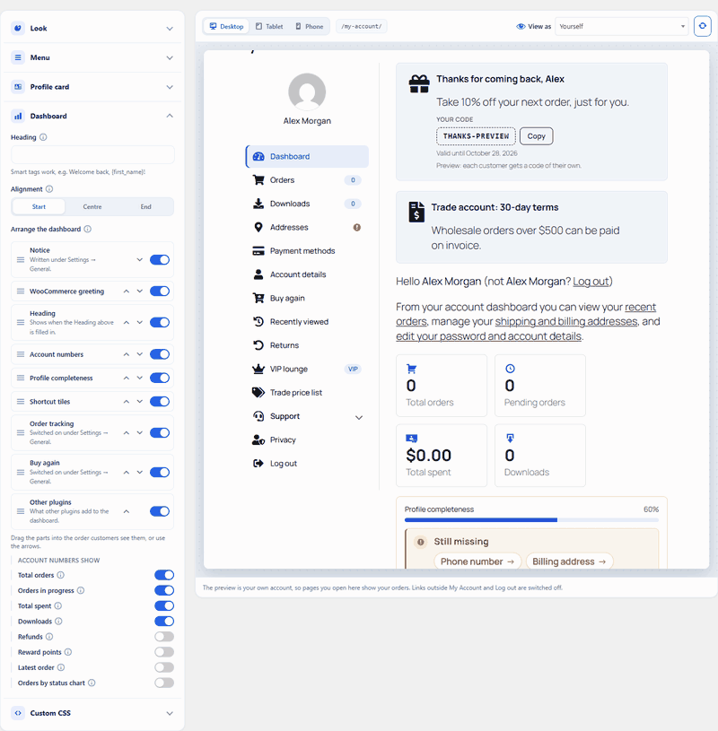

#### View as a Customer

Pick a customer in **View as** to see My Account exactly as they do: their menu, badges, offers
and dashboard. A bar lists what is hidden from them, and why. It is read-only: nothing is
changed, sent or counted for the customer.

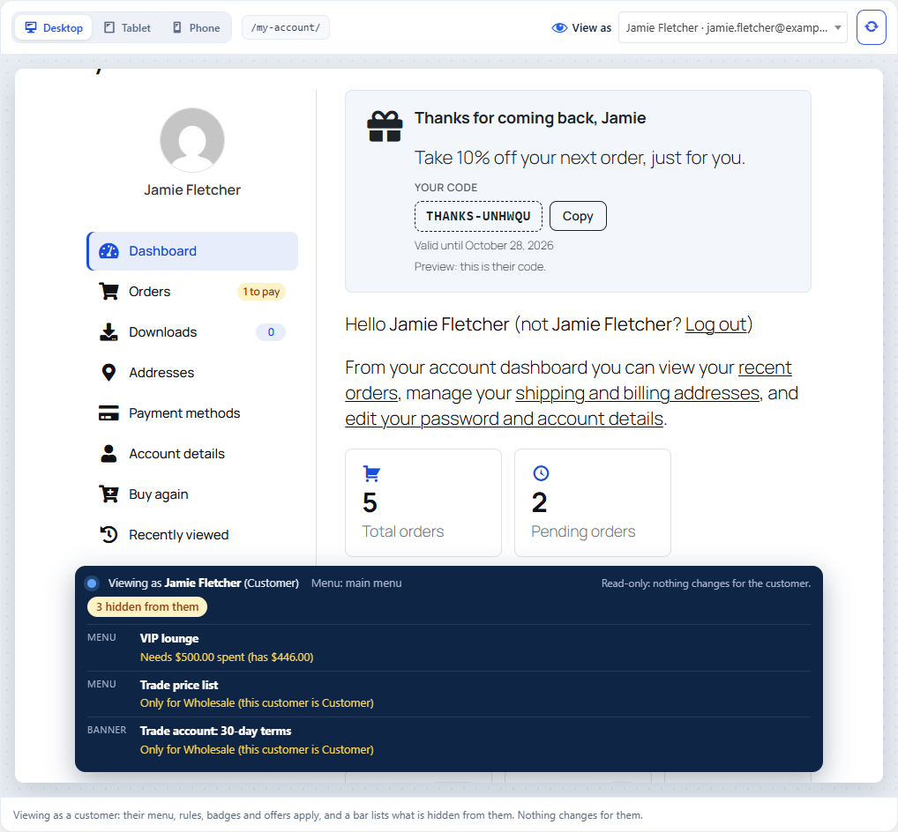

### Banners and Personal Offers

Banners are reusable blocks shown on any endpoint (set under the item's **Content** tab).

1. On **Banners**, click **Add banner**.
2. Choose **Widget** (icon, title, text, colours, optional count) or **Image**.
3. Add a **Link** to an endpoint or any URL, and set **Visibility** with the same rules as
   menu items.
4. Click **Save banner**.

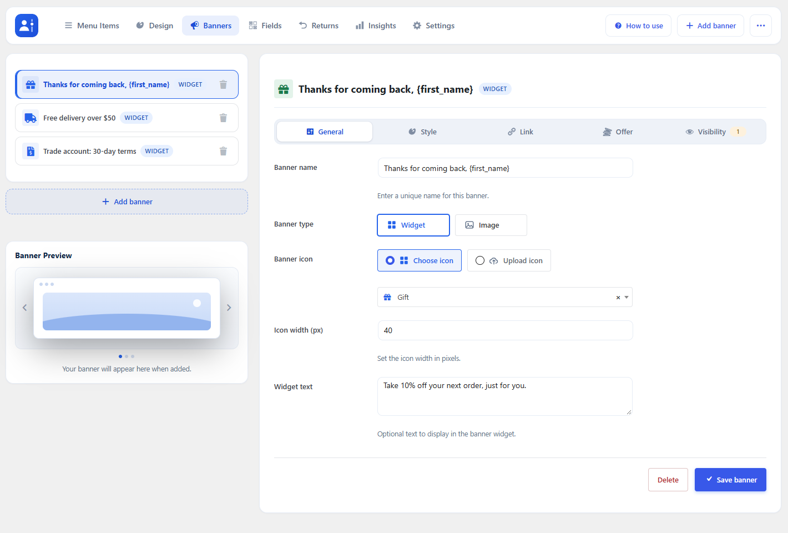

Switch on **Personal coupon** on the **Offer** tab and each customer who sees the banner gets
a one-use code of their own (percent or amount off, valid for N days, optional minimum spend
and free shipping). The banner shows the code with **Copy** and **Use it now**. Codes are
ordinary WooCommerce coupons.

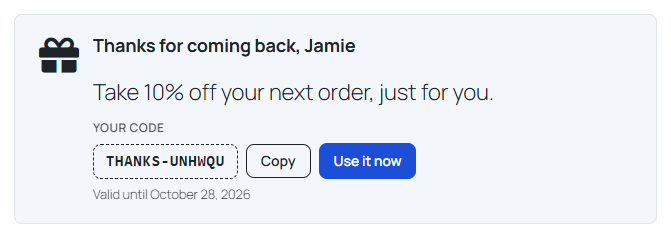

### Customer Fields

On **Fields**, add your own questions — VAT number, company, birthday, "How did you hear about
us?" — as text, number, date, dropdown, choices or a tick box. Show each one on the
**Registration form**, **Account details** and the **admin order screen**. Answers work as smart
tags, e.g. `{field_vat}`.

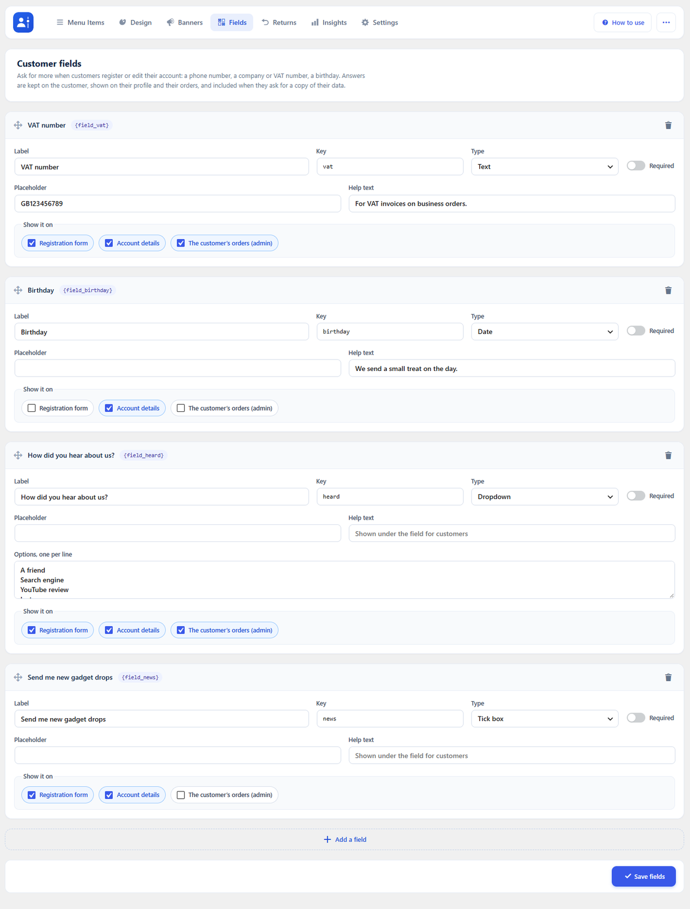

### Returns and Cancelling Orders

Switch both on under **Settings → Orders & privacy**.

- **Cancel orders** — customers cancel an order that has not shipped, for the number of hours
  you allow. Stock goes back.
- **Returns** — customers pick items from a completed order, a reason and an optional photo.
  You answer on the **Returns** tab; each status change emails the customer.

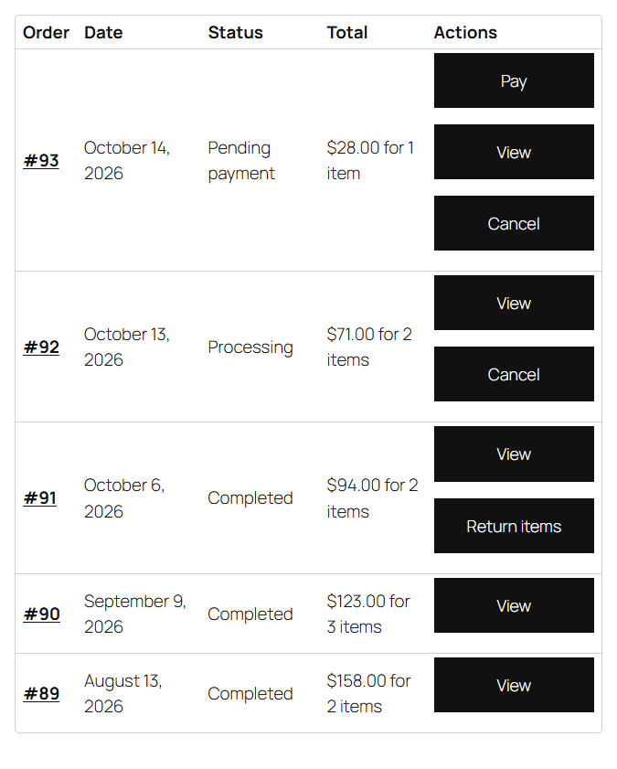

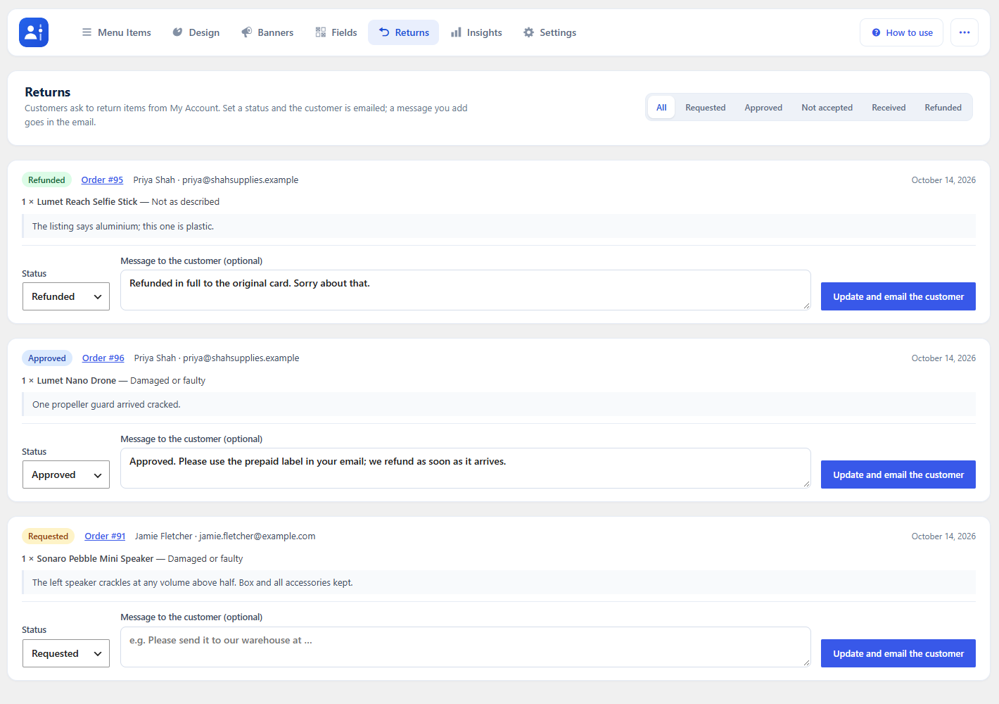

### Insights

**Insights** shows account page views, banner clicks and click rates, and how personal offers
convert, over 7, 30 or 90 days. Switch on **Record usage** under **Settings → General**. Only
customers are counted, as daily totals.

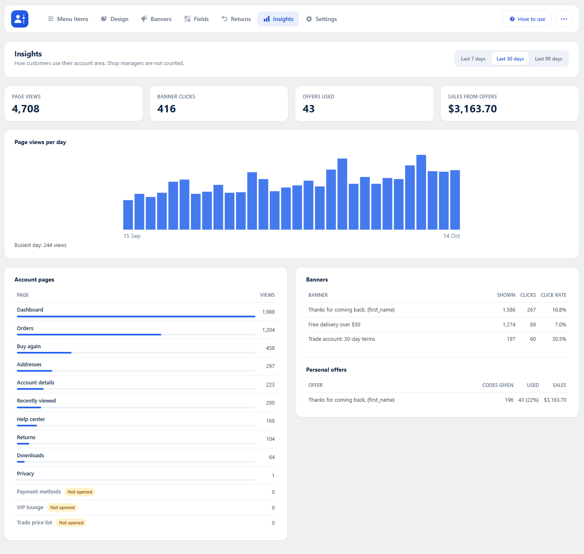

### Settings

- **General** — AJAX navigation, the default endpoint, login and logout redirects, a guest
  message, a dashboard notice, Record usage, and Buy again / Recently viewed / Order tracking.
- **Orders & privacy** — cancelling, returns and their reasons, address book, privacy page.
- **Presets & Reset** — save the design as a named preset, or reset everything to defaults.
- **Import / Export** — move the whole configuration to another site as a JSON file.

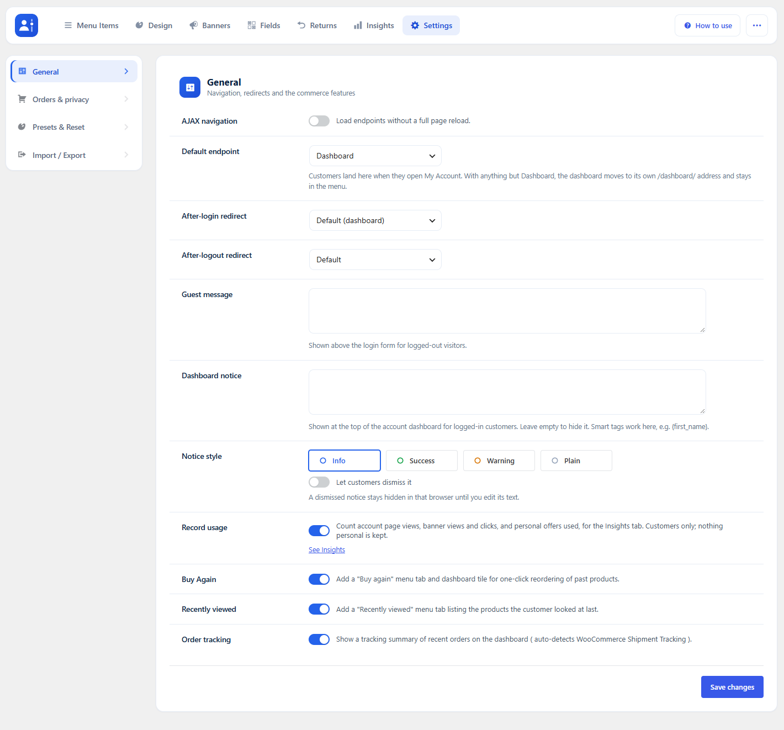

### Smart Tags

Use these in content, the dashboard heading, badges and banners: `{first_name}`,
`{last_name}`, `{display_name}`, `{user_email}`, `{order_count}`, `{total_spent}`,
`{download_count}`, `{member_since}`, `{last_login}`, `{cart_count}`, `{site_title}`,
`{shop_url}`, `{points_balance}`, `{membership_plan}`, `{field_…}` and, in a banner,
`{offer_code}`, `{offer_amount}`, `{offer_expiry}`. In the Classic editor, use **Add smart tags**.

### Developer Options

- Show the account menu anywhere with the `[acfw_account_menu]` shortcode, the **Account Menu**
  block or widget. Classic themes also get a **My Account** box under **Appearance → Menus**.
- Override templates by copying files from `templates/` to `yourtheme/my-account-dashboard-builder/`.
- Filters include `acfw_status_badges`, `acfw_dashboard_blocks`, `acfw_smart_tag_values`,
  `acfw_item_is_visible` and `acfw_endpoint_content`.

### Compatibility with Third-Party WooCommerce Plugins

- Account pages added by **Subscriptions**, **Memberships**, **Bookings**, points and wallet
  plugins appear in the menu with fitting icons; arrange them like any other item.
- **YITH** and **TI WooCommerce Wishlist** get a Wishlist page inside My Account.
- **Points & Rewards**, **YITH Points** and **myCred** feed `{points_balance}` and the Reward
  points stat; **Memberships** feeds `{membership_plan}`.
- HPOS, the Cart and Checkout blocks, **WPML** and **Polylang** are supported.

---

## Usage

What customers see on the front end.

### Customer Self-Service

Switch these on under **Settings**; each adds a menu item and a dashboard part.

- **Buy again** — past purchases with **Add to cart**, and **Reorder my last order**.
- **Recently viewed** — the products the customer looked at last.
- **Order tracking** — recent orders on the dashboard, with numbers from WooCommerce Shipment Tracking.
- **Address book** — more saved addresses, used for shipping or billing in a click.
- **Privacy page** — customers ask for a copy of their data, or for it to be erased.

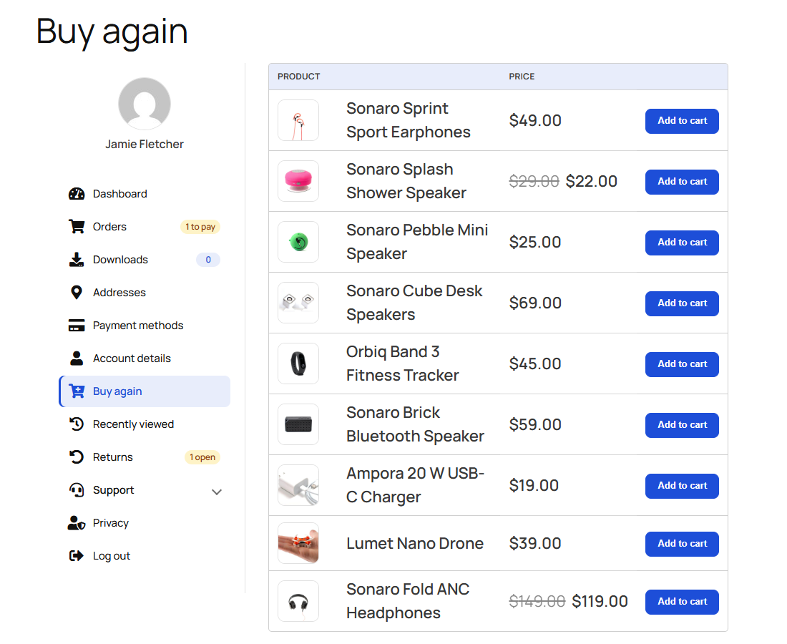

---

## Troubleshooting

Known errors or issues and how to solve them.

### Personal offer codes do not appear

Coupons must be switched on in **WooCommerce → Settings → General**. Shop managers see a
`PREFIX-PREVIEW` code instead of a real one; check with **View as a Customer**.

### "Free shipping too" has no effect on an offer

The store needs a free shipping method that accepts a coupon.

### The menu looks doubled or items jump around

Use only one My Account menu builder at a time. Two plugins rewriting the same menu will
conflict; deactivate the other customizer.

### Saved addresses are missing at checkout

The address book picker shows on the classic checkout. The Checkout block does not list
the saved addresses.

---

## FAQs

### Do I need to edit theme templates?

No. The plugin replaces the WooCommerce account menu and endpoint output through the hooks
WooCommerce already provides. Nothing is copied into your theme.

### What happens if I deactivate the plugin?

My Account falls back to the standard WooCommerce menu. Your configuration is kept, so
reactivating restores everything. Uninstall from the Plugins screen removes only this plugin’s
data.

### Can different customers get different menus?

Yes. On Menu Items, add a menu for a customer group (for example wholesale or members). It
starts as a copy of the main menu; remove or reorder items as needed. Item settings stay
shared, and everyone else keeps the main menu.

### Are personal offer codes ordinary WooCommerce coupons?

Yes. They appear under **Marketing → Coupons**, limited to one use and to the customer’s email.
Coupons must be enabled in **WooCommerce → Settings → General**.

### Is it compatible with HPOS and the block cart/checkout?

Yes. Compatibility with High-Performance Order Storage and the block-based cart and checkout
is declared. Orders are read through the WooCommerce CRUD API only.

### Can I move my setup from staging to the live site?

Yes. Use **Settings → Import / Export** to download a JSON file of the configuration, then
**Import** it on the other site.
